# NeoEduCore — Diagramas del sistema

**Rehechos desde cero el 13 de octubre de 2026, desde el código de la rama `Darwin`.**

> Estos diagramas describen el **sistema construido**, no el diseño previsto. Se derivan de
> `database/sql/01_schema.sql` (artefacto de `pg_dump`), `routes/api.php`, `routes/console.php`,
> `bootstrap/app.php`, `app/Models/`, `app/Services/`, `app/Jobs/` y `docker/entrypoint.sh`.
> Cuando el informe del TFG y esto no coincidan, manda esto: las divergencias están
> inventariadas en [`ANALISIS_MODELO_DATOS_TFG.md`](ANALISIS_MODELO_DATOS_TFG.md) §10.
>
> **Qué cambió respecto a la versión del 8 de agosto.** El esquema pasó de 27 a 29 tablas
> (`study_resource_groups`, `exam_analysis_narratives`), el tutor y el análisis de IA salieron
> de la petición y van por **cola**, hay **WebSocket** y **notificaciones**, las cuentas nuevas
> nacen **activas con contraseña temporal** (ya no «inactivas»), los exámenes se **abren y
> cierran solos**, y el despliegue son **tres instancias** de la misma imagen.

## Cómo se trabaja con este documento

**Este `.md` es la fuente.** Los diagramas se escriben aquí una sola vez, en Mermaid.

**Para verlos en grande hay una versión HTML**, con cada figura a ancho completo, zoom y
pantalla completa:

```bash
php artisan diagramas:html      # genera docs/diagramas.html
```

`docs/diagramas.html` es un **artefacto derivado**: si se edita a mano, se pierde en la
siguiente ejecución.

**Validación.** Los diagramas se comprueban con el parser real de Mermaid, sin navegador:

```bash
npm install                    # mermaid + jsdom, las únicas dependencias node del repo
npm run validar-diagramas      # scripts/validar-diagramas.mjs
```

Si cambia el esquema, las cifras de la §1 se recomprueban con:

```bash
grep -c "FOREIGN KEY"            database/sql/01_schema.sql   # 62 (61 de dominio + 1 notifications)
grep -c "^CREATE TABLE public\." database/sql/01_schema.sql   # 29 (23 de dominio + 6 de framework)
```

---

## Índice

1. [Modelo entidad-relación](#1-modelo-entidad-relación) — [mapa](#11-mapa-de-relaciones) · [personas](#12-personas-y-estructura-académica) · [evaluación](#13-evaluación) · [seguimiento, IA y apoyo](#14-seguimiento-ia-y-apoyo)
2. [Aislamiento multi-tenant](#2-aislamiento-multi-tenant)
3. [Diagrama de clases](#3-diagrama-de-clases) — [personas y traits](#31-personas-estructura-y-los-traits-de-seguridad) · [evaluación](#32-evaluación) · [seguimiento e IA](#33-seguimiento-ia-y-apoyo)
4. [Arquitectura](#4-arquitectura) — [despliegue](#41-despliegue-tres-instancias) · [cadena de middleware](#42-cadena-de-middleware)
5. [Flujo de autenticación](#5-flujo-de-autenticación)
6. [Flujo de examen](#6-flujo-de-examen) — [estados](#61-estados-del-examen) · [intento](#62-ciclo-de-vida-del-intento) · [después de entregar](#63-después-de-entregar-el-análisis-de-ia)
7. [Flujo del tutor IA](#7-flujo-del-tutor-ia)
8. [Trabajo en segundo plano](#8-trabajo-en-segundo-plano)
9. [Diagrama de casos de uso](#9-diagrama-de-casos-de-uso)
10. [Diagrama de proceso: el ciclo académico](#10-diagrama-de-proceso-el-ciclo-académico)

---

## 1. Modelo entidad-relación

**23 tablas de dominio** —17 entidades y 6 pivotes— con **61 claves foráneas**. Aparte quedan
6 tablas de framework (`migrations`, `jobs`, `failed_jobs`, `password_reset_tokens`,
`personal_access_tokens` y `notifications`); `notifications` aporta la 62.ª FK
(`notifiable_id → users`).

Los 6 pivotes son `group_students`, `student_subjects`, `teacher_assignments`, `exam_targets`,
`student_answer_options` y `study_resource_groups`.

Va en **cuatro vistas**: un ERD de 23 tablas con todos sus atributos es ilegible a cualquier
tamaño. La §1.1 da la forma completa del modelo; las §1.2 a §1.4 entran al detalle por área, y
entre las tres están las 23 tablas sin repetir ninguna.

En las cuatro **se omiten las aristas de `institution_id`**: las lleva *toda* tabla de dominio
y saturarían la figura. Van en la [§2](#2-aislamiento-multi-tenant), donde además significan
algo. En los atributos solo figuran las columnas que cuentan una decisión.

### 1.1 Mapa de relaciones

La forma completa del modelo, sin atributos. Es la figura para enseñar el conjunto de un vistazo.

```mermaid
erDiagram
    institutions ||--o{ users : ""
    users ||--o| students : "perfil académico"
    users ||--o{ exams : "autoría, SET NULL"
    users ||--o{ study_resources : "publica, SET NULL"
    users ||--o{ calendar_events : "crea, SET NULL"

    students ||--o{ group_students : ""
    groups ||--o{ group_students : ""
    students ||--o{ student_subjects : ""
    subjects ||--o{ student_subjects : ""

    users ||--o{ teacher_assignments : "imparte"
    groups ||--o{ teacher_assignments : ""
    subjects ||--o{ teacher_assignments : ""

    subjects ||--o{ exams : "CASCADE"
    exams ||--o{ questions : ""
    questions ||--o{ question_options : ""
    exams ||--o{ exam_targets : ""
    groups ||--o{ exam_targets : ""
    exams ||--o{ exam_analysis_narratives : ""

    students ||--o{ exam_attempts : "presenta"
    exams ||--o{ exam_attempts : ""
    exam_attempts ||--o{ student_answers : ""
    questions ||--o{ student_answers : ""
    student_answers ||--o{ student_answer_options : ""
    question_options ||--o{ student_answer_options : ""

    students ||--o{ student_progress : "domina"
    subjects ||--o{ student_progress : ""
    students ||--o{ ai_recommendations : "recibe"
    exam_attempts ||--o{ ai_recommendations : "origina"
    students ||--o{ ai_chat_sessions : "conversa"
    ai_chat_sessions ||--o{ ai_tutor_incidents : "SET NULL"

    study_resources ||--o{ study_resource_groups : ""
    groups ||--o{ study_resource_groups : ""
    subjects ||--o{ study_resources : "SET NULL"
    exams ||--o{ calendar_events : "SET NULL"
    groups ||--o{ calendar_events : "SET NULL"
```

### 1.2 Personas y estructura académica

Quién es quién y cómo se agrupa. Las **tres** tablas pivote de aquí sostienen el ciclo
académico: la pertenencia a un aula, la matrícula en materias y la asignación del profesorado.

> **`teacher_assignments` es la pieza que hay que leer con atención.** Es la única fuente de
> la relación docente↔estudiante: «mis estudiantes» son los de las aulas que tengo asignadas, y
> solo en las materias que imparto. No se deduce de qué exámenes creó el docente.

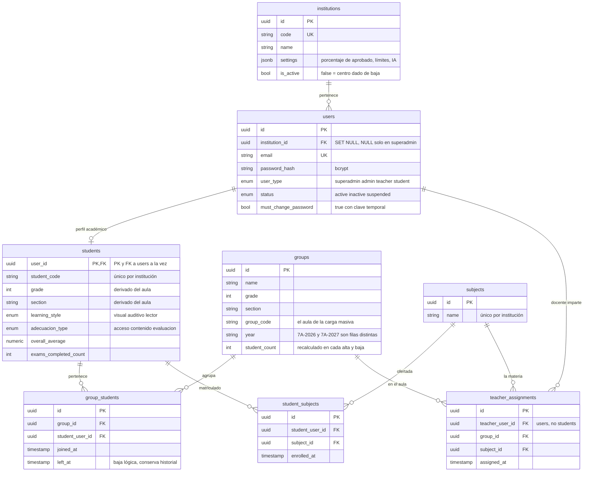

### 1.3 Evaluación

Del examen a la opción marcada, más la lectura de IA del grupo. Es la cadena que cascadea
entera al borrar una materia.

> **`created_by_teacher_id` es autoría, no permisos.** Registra quién redactó el examen y
> sirve para conservarlo cuando el docente se va (`SET NULL`). **No** decide qué estudiantes
> ve ese docente: eso sale de `teacher_assignments` (§1.2). `exam_targets` solo acepta aulas
> donde el autor tenga asignación **en la materia del examen**.

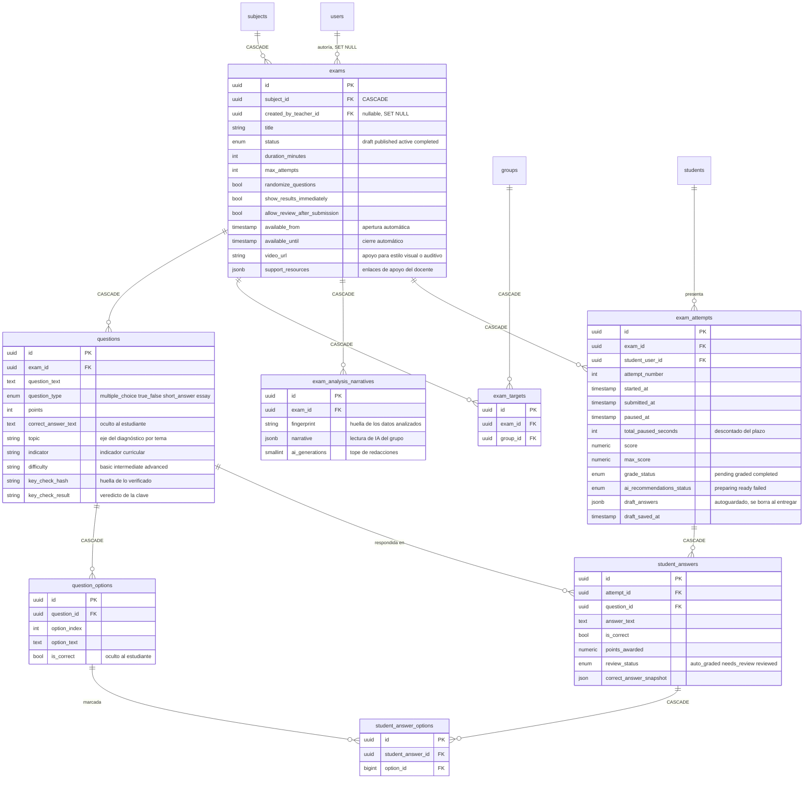

### 1.4 Seguimiento, IA y apoyo

Lo que se deriva de la evaluación —dominio por materia y recomendaciones—, el registro de
incidencias del tutor, el material de estudio y el calendario.

> **`ai_tutor_incidents` apunta a `users`, no a `students`, y con `SET NULL`.** Es una métrica
> de calidad del tutor: tiene que sobrevivir a que se borre el estudiante o la sesión, así
> que solo `institution_id` cascadea. No guarda el texto del mensaje, solo tipo y etapa.

```mermaid
erDiagram
    students ||--o{ student_progress : "domina"
    subjects ||--o{ student_progress : "medido en"
    students ||--o{ ai_recommendations : "recibe"
    subjects ||--o{ ai_recommendations : "CASCADE"
    exams ||--o{ ai_recommendations : "SET NULL"
    exam_attempts ||--o{ ai_recommendations : "origina, CASCADE"
    students ||--o{ ai_chat_sessions : "conversa"
    subjects ||--o{ ai_chat_sessions : "SET NULL"
    exams ||--o{ ai_chat_sessions : "SET NULL"
    ai_chat_sessions ||--o{ ai_tutor_incidents : "SET NULL"
    users ||--o{ ai_tutor_incidents : "SET NULL"
    users ||--o{ study_resources : "publica, SET NULL"
    subjects ||--o{ study_resources : "SET NULL"
    study_resources ||--o{ study_resource_groups : "CASCADE"
    groups ||--o{ study_resource_groups : "CASCADE"
    users ||--o{ calendar_events : "crea, SET NULL"
    exams ||--o{ calendar_events : "SET NULL"
    groups ||--o{ calendar_events : "SET NULL"
    users ||--o{ notifications : "campana, CASCADE"

    student_progress {
        uuid id PK
        uuid student_user_id FK
        uuid subject_id FK
        numeric mastery_percentage "AVG en SQL"
        timestamp reset_at "corte para repitentes"
    }
    ai_recommendations {
        uuid id PK
        uuid student_user_id FK
        uuid subject_id FK
        uuid exam_id FK "nullable"
        uuid attempt_id FK "nullable"
        enum recommendation_type "strength weakness resource action"
        enum generated_by "heuristic ai"
        string audience "estudiante o docente"
        text recommendation_text
        json resource "URL de la lista blanca"
        timestamp generated_at "agrupa cada generación"
    }
    ai_chat_sessions {
        uuid id PK
        uuid student_user_id FK
        uuid subject_id FK "nullable"
        uuid exam_id FK "nullable"
        jsonb messages "recortado a un tope"
        timestamp awaiting_reply_since "turno asíncrono en curso"
        timestamp ended_at
    }
    ai_tutor_incidents {
        uuid id PK
        uuid student_user_id FK "users, nullable"
        uuid session_id FK "nullable"
        enum type "pii too_short too_long blocked_url model_error prompt_injection"
        enum stage "chat diagnosis"
        timestamp occurred_at
    }
    study_resources {
        uuid id PK
        uuid subject_id FK "nullable"
        string title
        enum resource_type "video article exercise book pdf link other"
        string url "validado contra lista blanca"
        string difficulty "basic intermediate advanced"
        int grade_min
        int grade_max
    }
    study_resource_groups {
        uuid id PK
        uuid study_resource_id FK
        uuid group_id FK "recurso visible solo a esas aulas"
    }
    calendar_events {
        uuid id PK
        uuid exam_id FK "nullable"
        uuid group_id FK "nullable, aviso de aula"
        uuid created_by FK "nullable"
        string title
        enum event_type "exam activity reminder meeting"
        string audience "a quién va el aviso"
        timestamp start_at
        timestamp end_at
    }
    notifications {
        uuid id PK
        uuid notifiable_id FK "users"
        jsonb data
        timestamp read_at
    }
```

### Siete decisiones del modelo que conviene saber leer

| Decisión | Dónde se ve | Por qué |
|---|---|---|
| **`students.user_id` es PK y FK a la vez** | `students` | Un estudiante *es* un usuario con perfil académico, no una entidad paralela. Las relaciones del dominio estudiante apuntan a `students(user_id)`, no a `users(id)`: así la base rechaza un intento de examen a nombre de un docente |
| **`exams.created_by_teacher_id` es *nullable* con `SET NULL`** | `users → exams` | Permite dar de baja a un docente sin perder los exámenes que dejó al centro |
| **`exams.subject_id` es `CASCADE`** | `subjects → exams` | Eliminar una materia elimina su contenido académico, en cadena: materia → exámenes → preguntas → intentos → respuestas. Destructivo a propósito |
| **`group_students.left_at`** | `group_students` | La baja de un aula es **lógica**: la fila se conserva como historial académico |
| **`teacher_assignments` es una tabla, no una inferencia** | `users → teacher_assignments → groups` | El permiso del docente es un **dato que crea el administrador**, no algo que se deduzca de lo que el docente hizo. Nace vacía: nadie ve a nadie hasta que el admin asigna |
| **`student_code` es único *por institución*** | `students` | Es un identificador interno de cada centro: dos colegios pueden numerar «EST-0001» cada uno |
| **`institution_id` de `users` es `SET NULL`; el de las demás es `CASCADE`** | `institutions → users` | Dar de baja un centro no borra a las personas, y el `NULL` es justo la forma del superadmin (§2) |

---

## 2. Aislamiento multi-tenant

Cada tabla de dominio lleva `institution_id` con clave foránea: **22 columnas, 21 cascadean y
una —`users`— hace `SET NULL`.**

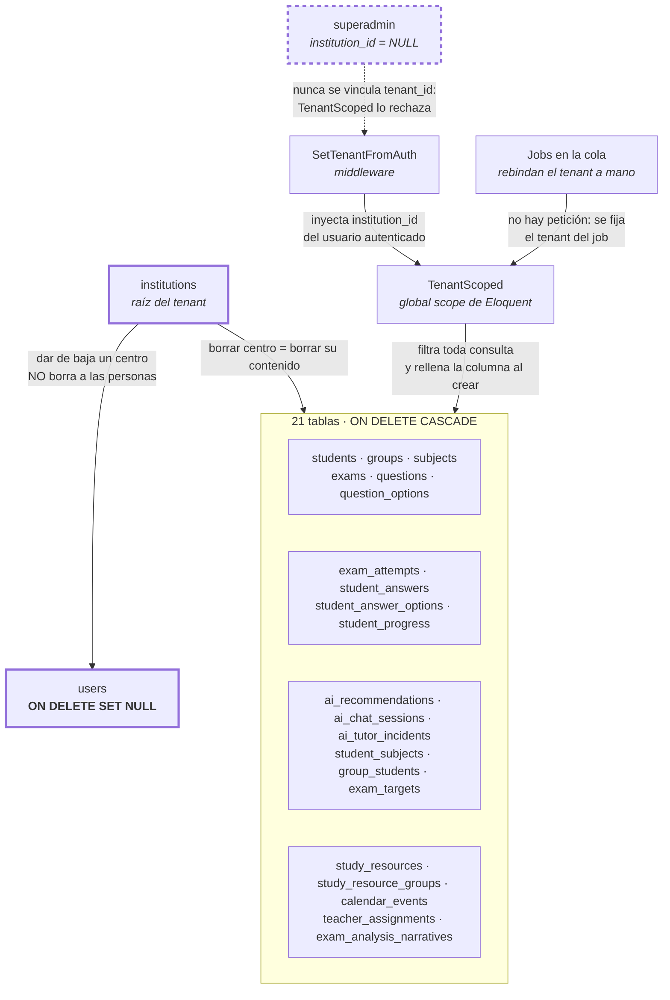

**El aislamiento vive en dos capas, y esa redundancia es deliberada.** `TenantScoped` filtra
en la aplicación —si detecta contexto HTTP sin `institution_id`, lanza `RuntimeException` en
vez de devolver datos de más—. Las claves foráneas lo respaldan en la base: sin ellas era
posible escribir un `institution_id` inexistente y romper el aislamiento por debajo del ORM.

> **La seguridad a nivel de fila de PostgreSQL (RLS) no aísla instituciones.** La conexión
> usa un rol con *bypass* y no hay políticas: quien aísla es `TenantScoped`.

**Fuera de una petición no hay `SetTenantFromAuth`.** Los jobs de la cola (análisis de IA, tutor
asíncrono, avisos) fijan el tenant a mano; si no, `TenantScoped` ni filtraría ni rellenaría
`institution_id` al crear.

**Cuatro modelos no usan `TenantScoped`**: `Institution`, `User`, `AccessToken` y
`AiTutorIncident`. Los tres primeros porque son la raíz del tenant o el soporte de la
autenticación; el cuarto porque solo lo lee el superadmin, que no tiene tenant, y el único
endpoint que lo expone (`GET /api/platform/ai-tutor-metrics`) devuelve solo agregados. En los
cuatro `institution_id` se escribe siempre explícito.

**El superadmin es la excepción por omisión, no por permiso.** Es el operador de la plataforma
—da de alta centros y a sus administradores— y no pertenece a ninguna institución. Como
`SetTenantFromAuth` nunca vincula un `tenant_id` para él, **toda** consulta a un modelo con
`TenantScoped` falla: aunque una ruta académica se abriera a su rol por descuido, no
devolvería datos. El admin de un centro, por su parte, no tiene ninguna ruta hacia
`/api/institutions`; gestiona lo suyo por `/api/system/config`.

---

## 3. Diagrama de clases

20 clases Eloquent: las 17 entidades, `StudentSubject`, `TeacherAssignment` y `AccessToken`.
Los 4 pivotes restantes (`group_students`, `exam_targets`, `student_answer_options`,
`study_resource_groups`) se manipulan por *query builder* y no tienen modelo.

Va en tres vistas por la misma razón que el ERD. La §3.1 incluye los *traits*, que son lo que
no se ve en el esquema y sostiene la seguridad por rol.

### 3.1 Personas, estructura y los traits de seguridad

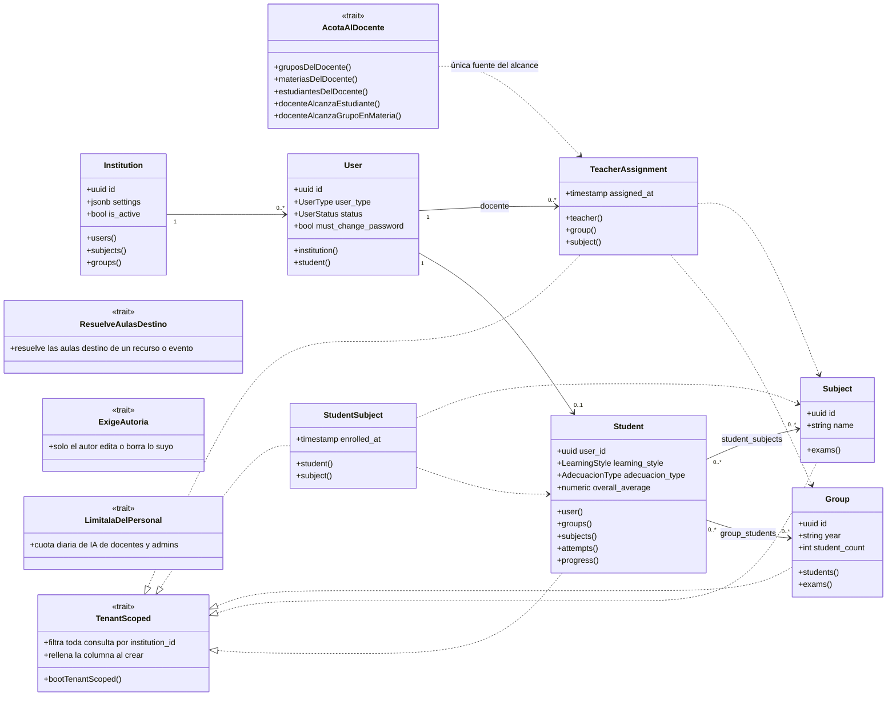

**`AcotaAlDocente` es el trait que hay que mirar si se añade un endpoint.** Resuelve «mis
estudiantes» en un solo sitio; antes esa regla estaba copiada a mano en varios controladores y
faltaba en otros, que por eso servían el historial completo de cualquier alumno a cualquier
docente. Cualquier endpoint nuevo que toque alumnado, resultados o recomendaciones debe pasar
por él.

### 3.2 Evaluación

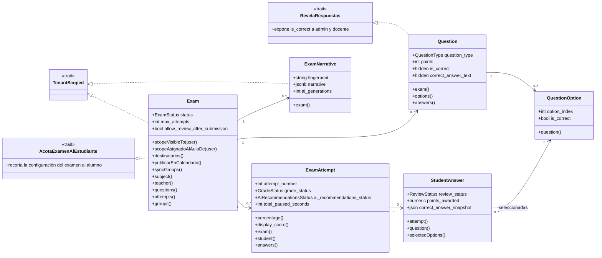

### 3.3 Seguimiento, IA y apoyo

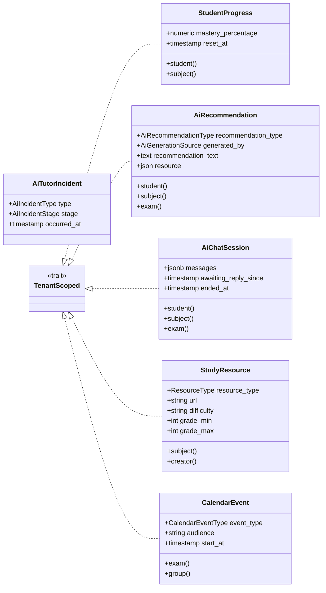

**`AiTutorIncident` no usa `TenantScoped`, y es deliberado** (ver §2): lo lee el superadmin,
que no tiene tenant, y solo en agregado.

Los *traits* `RevelaRespuestas` y `AcotaExamenAlEstudiante` deciden **qué campos ve cada rol**
sobre las mismas filas, y `Exam::scopeVisibleTo()` centraliza qué exámenes ve un alumno:
activo, dentro de ventana y asignado a sus aulas.

---

## 4. Arquitectura

API REST pura: **el backend no sirve HTML en ninguna ruta de la API.** La única capa de
presentación son las vistas Blade del correo.

### 4.1 Despliegue: tres instancias

La **misma imagen Docker** se despliega tres veces; lo único que cambia es el comando
(`docker/entrypoint.sh`, o la variable `CONTAINER_ROLE`). Si el WebSocket cae no se lleva la
API, y cada pieza se reinicia o escala por separado.

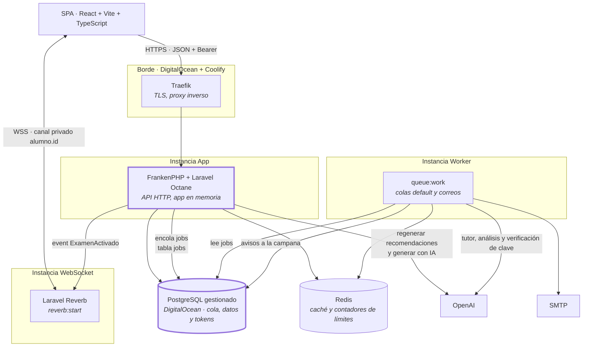

**El límite real es el presupuesto de conexiones a la base, no la RAM ni la CPU.** Cada worker
de Octane retiene una conexión, y la base gestionada admite pocas (25 en la de pruebas), de
ahí la variable `OCTANE_WORKERS`. Con esta base (misma región) el requisito de 200 alumnos
simultáneos se cumplió; con la remota anterior colapsaba hacia los 25 por la latencia de cada
consulta. Informe en [`INFORME_PRUEBAS_CARGA_OCT_2026.md`](INFORME_PRUEBAS_CARGA_OCT_2026.md).

**`CACHE_STORE=redis` es imprescindible en producción**: los contadores de los límites de
peticiones viven en la caché, y con `array` cada worker de Octane llevaría el suyo.

**`queue:work` también lo es.** Sin él no salen los correos, ni la carga masiva, ni el tutor
asíncrono, ni el análisis de IA. Como red de seguridad, el *scheduler* también drena la cola
cada minuto (§8).

### 4.2 Cadena de middleware

El orden importa: lo barato y lo que rechaza va primero.

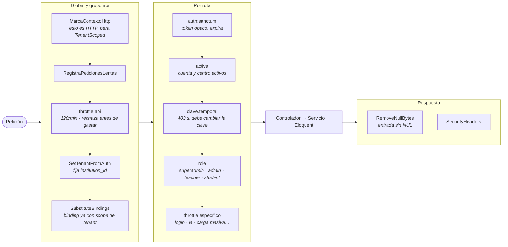

**Por qué `throttle:api` va primero:** rechaza el exceso *antes* de resolver tenant,
autenticación o modelos, que es donde está el coste. **Por qué `SetTenantFromAuth` va antes de
`SubstituteBindings`:** para que el *route model binding* ya resuelva con el scope de
institución activo; si no, un `{exam}` de otro centro se resolvería y solo fallaría después.

**`clave.temporal` decide por nombre de ruta**, no por URL: una cuenta con contraseña
temporal solo puede ver su sesión, cerrarla y cambiar la contraseña; todo lo demás es 403.

---

## 5. Flujo de autenticación

Una cuenta nueva **nace activa**, con una **contraseña temporal aleatoria** que llega por
correo y que debe cambiarse en el primer acceso. Hay tres puertas de alta y todas acaban igual.

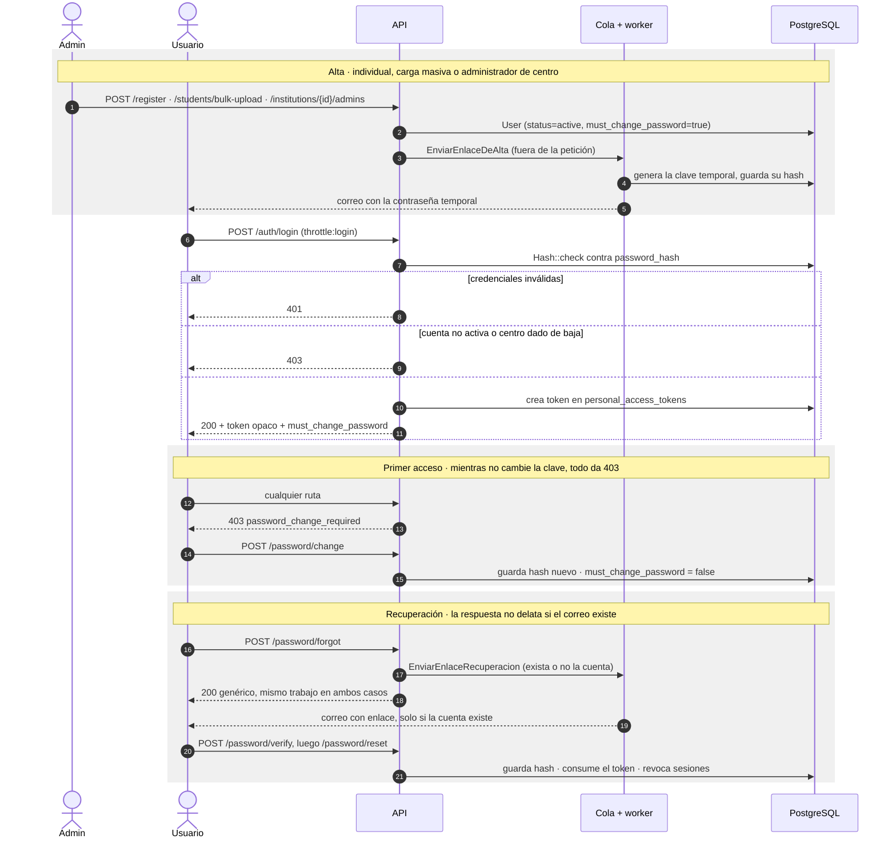

**Reglas que sostienen el flujo:**

- **El tiempo de `/password/forgot` no puede delatar qué correos están dados de alta.** Por eso
  la petición solo valida y encola `EnviarEnlaceRecuperacion`, exista la cuenta o no: el
  trabajo que depende de la cuenta ocurre en el worker, donde nadie lo cronometra.
- **El hash bcrypt y el SMTP van a la cola.** Generar la clave cuesta ~180 ms; una carga de
  300 cuentas tardaba casi un minuto solo en eso.
- **El administrador no ve ni elige la clave temporal.** La recibe solo el titular de la cuenta.
- Una cuenta `suspended` no entra ni recupera la contraseña: la bloqueó un administrador a
  propósito.

> ⚠️ Los tokens son **opacos** contra `personal_access_tokens` (Sanctum), no JWT. El informe
> dice JWT en dos sitios; es una de las correcciones de `ANALISIS_MODELO_DATOS_TFG.md` §9.1.

---

## 6. Flujo de examen

### 6.1 Estados del examen

El docente cambia el estado a mano, y además un *scheduler* lo hace solo cada minuto cuando
llegan las fechas.

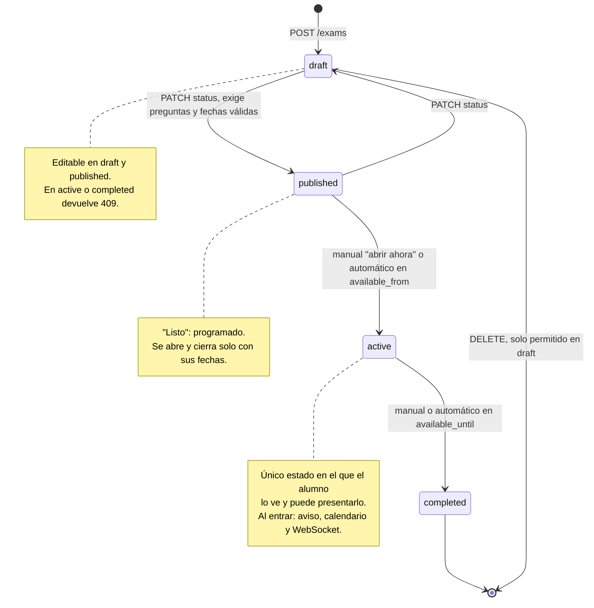

**Al pasar a `active`** —a mano o por el scheduler— ocurren tres cosas: `NotificarExamenDisponible`
(una notificación por alumno de las aulas destino, en la cola), `publicarEnCalendario()` (un
evento en el calendario de cada aula) y el evento `ExamenActivado` por WebSocket, para quien
tiene la página abierta. `active` solo se alcanza una vez, así que el aviso no se duplica.

### 6.2 Ciclo de vida del intento

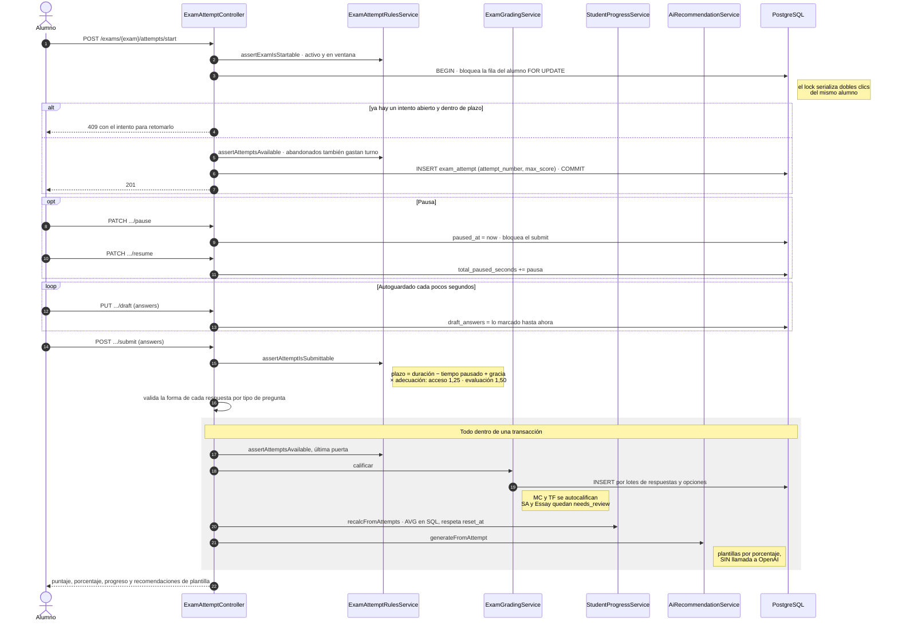

**Si el tiempo se agota y el alumno no envía** (pestaña cerrada, conexión perdida), no se pierde
nada: el scheduler (`exams:cerrar-intentos-vencidos`, cada minuto) entrega por él el último
borrador autoguardado, **pasado el plazo más `EXAM_AUTO_SUBMIT_DELAY_SECONDS` (120 s)**. Esa
espera da margen a que el frontend envíe por sí mismo al llegar el cronómetro a 0. La entrega
automática usa el mismo camino que la manual (calificación, progreso y recomendaciones), así que
la nota queda igual que si la hubiera enviado él; lo que no llegó a guardarse cuenta como en
blanco y las respuestas inválidas del borrador se descartan.

> ⚠️ **La recomendación del submit no la escribe la IA.** `generateFromAttempt` es un
> `if/elseif/else` sobre el porcentaje con textos fijos. Es deliberado: una llamada de segundos
> dentro de la transacción ataría un worker justo en el pico de concurrencia, cuando todos
> entregan a la vez. El análisis con IA llega después, por la cola (§6.3). **El informe lo
> describe al revés**: ver `ESTADO_Y_PENDIENTES.md` §3.6 nº 1.

### 6.3 Después de entregar: el análisis de IA

La primera vez que el alumno abre sus resultados se encola el análisis; el front lo sondea.

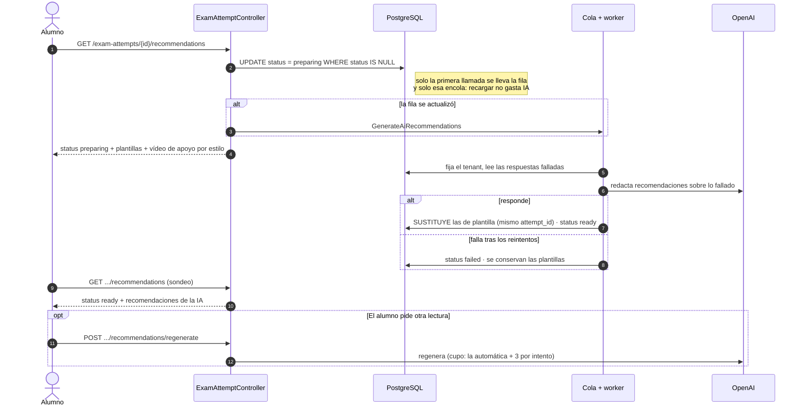

**Sustituir, no acumular.** Si se guardaran los dos lotes el alumno vería ocho tarjetas, la
mitad genéricas, sin saber cuáles son las buenas. `attempt_id` permite reemplazar sin adivinar
por fechas, y también contar el cupo de regeneraciones.

---

## 7. Flujo del tutor IA

El chat tiene **dos modos**: síncrono, que ocupa un worker HTTP mientras OpenAI contesta, y
asíncrono (`async: true`), que encola el turno y deja el worker HTTP libre.

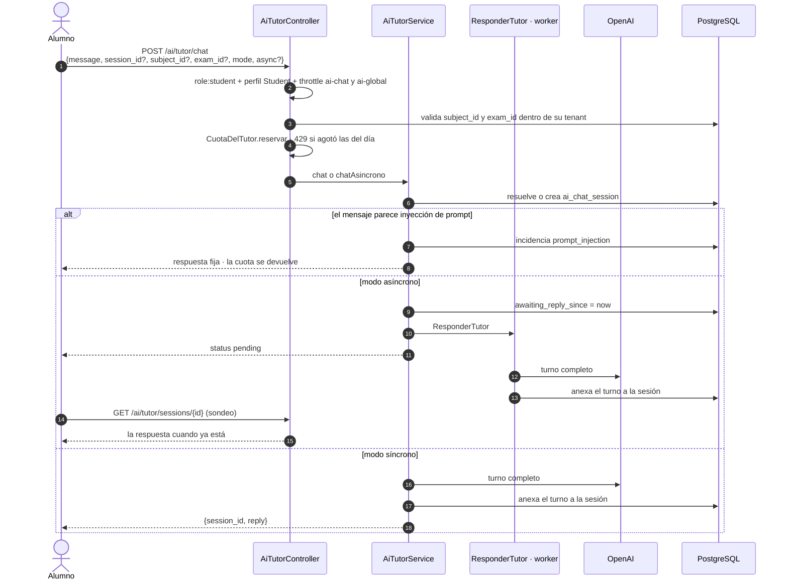

**Qué arma el «turno completo»:** el *system prompt* del alumno (grado, estilo y % de dominio
por materia, **nunca el nombre**; en caché), el detalle del examen o de la materia si la
conversación es sobre uno —incluidas las preguntas falladas—, la directiva del modo como turno
**de sistema** (nunca pegada al texto del alumno, para que no pueda fabricarla) y el historial
acotado. La respuesta pasa por `AiOutputValidator` y por `sinFugas`, que cortan PII, enlaces
fuera de la lista blanca y fugas del propio prompt, y devuelven un mensaje de reserva si algo
falla.

**Un solo intento en el worker.** `callOpenAi` ya convierte cualquier fallo del modelo en el
mensaje de reserva; reintentar por otra causa podría anexar el turno dos veces. Si el job
falla, `failed()` anexa el mensaje de reserva y libera la sesión.

### La frontera de privacidad

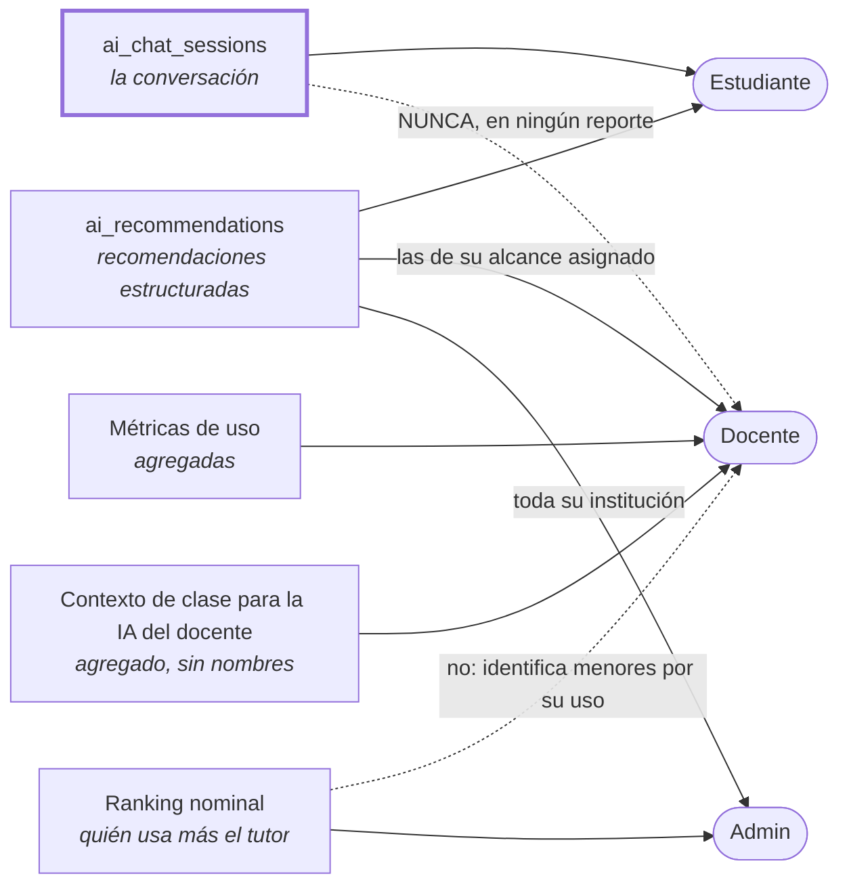

**La frontera no es alumno/docente, sino conversación/recomendación.** El docente nunca ve un
mensaje del chat; su seguimiento se apoya en las recomendaciones, que son el artefacto
pedagógico, y en el análisis agregado del grupo. Fijado como prueba en
`TutorStrategiesTest::test_chat_history_never_appears_in_the_strategies_report`.

---

## 8. Trabajo en segundo plano

Todo lo lento o que no debe retener la petición sale por la cola (`jobs`, en PostgreSQL), y el
*scheduler* hace de red de seguridad.

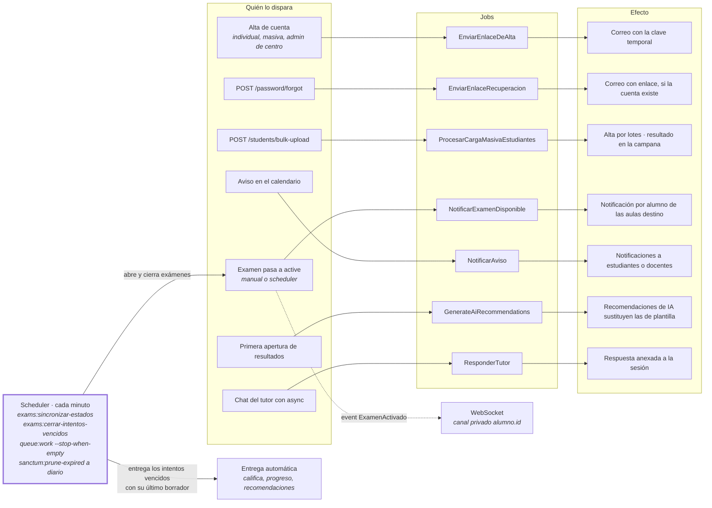

**Una sola regla común: el tenant se fija a mano dentro del job**, porque fuera de una petición
no hay `SetTenantFromAuth` (§2). Y otra de diseño: los avisos se insertan **en una consulta por
lote**, no una por destinatario, para que el coste no crezca con el tamaño del aula.

**Dos colas.** El worker procesa `default` y `correos`, y producción debe hacerlo igual
(`--queue=default,correos`); si solo escucha `default`, los correos no salen.

**El scheduler corre dentro del Worker** (`schedule:work`, lanzado por el entrypoint con
`CONTAINER_ROLE=worker`); no hace falta una tarea programada aparte en Coolify.

El *scheduler* corre `exams:sincronizar-estados` y `exams:cerrar-intentos-vencidos` **antes** del drenado de la cola: las tareas
se ejecutan en orden y `queue:work` puede tardar hasta 55 s.

---

## 9. Diagrama de casos de uso

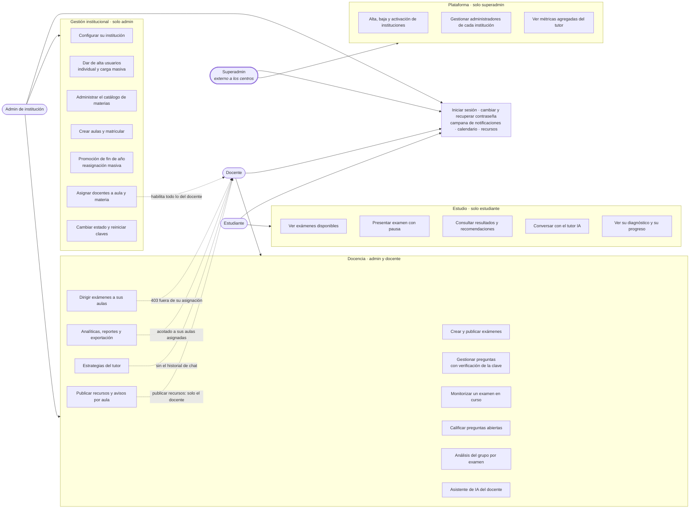

**Precisiones que el informe no recoge:**

- `UserType` tiene **cuatro** roles: `superadmin`, `admin`, `teacher` y `student`. El rol
  `parent` se retiró el 08/08/2026 por no tener rutas ni una sola fila real. El superadmin es
  **externo** a las instituciones y su alcance se agota en dos CRUD: instituciones y sus
  administradores.
- **El docente no es un admin recortado, y su alcance no se lo da él.** Lo fija el
  administrador en `teacher_assignments`; fuera de sus aulas asignadas no ve estudiantes,
  resultados, recomendaciones ni estrategias, y ni siquiera puede dirigir un examen a un aula
  ajena. La membresía de las aulas también es admin-only, para que no pueda ampliarse el
  alcance metiendo alumnos en un aula suya.
- **Los recursos de estudio los publica solo el docente**, por aula (`study_resource_groups`);
  el administrador los ve pero no los crea.
- El administrador de institución **no ve el catálogo de instituciones**: su centro lo
  configura por `/api/system/config`.
- Las cuentas con **clave temporal** solo pueden cambiarla (§4.2), sea cual sea su rol.

---

## 10. Diagrama de proceso: el ciclo académico

El proceso completo de un curso, desde la matrícula hasta la promoción del año siguiente.

```mermaid
flowchart TB
    START(["Inicio de curso"])

    A["Admin crea las aulas del año<br/><i>llevan year: 7A-2026 ≠ 7A-2027</i>"]
    A2["Admin asigna docentes<br/><i>teacher_assignments: aula + materia</i>"]
    B["Alta de estudiantes<br/><i>la carga masiva exige la columna aula<br/>y matricula en group_students</i>"]
    C["Alumno recibe su clave temporal<br/><i>la cambia en el primer acceso</i>"]
    D["Matrícula en materias<br/><i>student_subjects</i>"]

    E["Docente crea el examen<br/><i>draft</i>"]
    F["Añade preguntas y opciones<br/><i>la IA verifica la clave</i>"]
    G["Dirige a sus aulas y fija fechas<br/><i>exam_targets · 403 si no las tiene</i>"]
    H["Publica: queda Listo<br/><i>el scheduler lo abre y lo cierra</i>"]

    I["Alumno presenta el examen"]
    J["Corrección automática<br/><i>MC y TF</i>"]
    K{"¿Hay preguntas<br/>abiertas?"}
    L["Docente califica a mano<br/><i>needs_review → reviewed</i>"]
    M["Recalcular dominio por materia<br/><i>student_progress</i>"]
    N["Recomendaciones<br/><i>plantilla al entregar, IA después</i>"]

    O["Reportes, analíticas y análisis del grupo"]
    P["Alumno consulta al tutor IA"]

    Q{"Fin de curso:<br/>¿promovido?"}
    R["Reasignar al aula<br/>del grado siguiente"]
    S["Reasignar al mismo grado<br/>del año nuevo"]
    T["Resetear progreso<br/><i>marca reset_at</i>"]
    END(["Curso siguiente"])

    START --> A --> A2 --> B --> C --> D
    D --> E --> F --> G --> H
    H --> I --> J --> K
    K -->|sí| L --> M
    K -->|no| M
    M --> N --> O
    N --> P
    P --> O
    O --> Q
    Q -->|promovido| R --> END
    Q -->|repitente| S --> T --> END

    style Q stroke-width:3px
    style T stroke-width:3px
    style A2 stroke-width:3px
```

**Los dos primeros pasos bloquean todo lo demás.** Sin `teacher_assignments` el docente no ve
a ningún estudiante —la tabla nace vacía a propósito—, y sin la columna `aula` en la carga
masiva el alumno queda sin matrícula, que en la práctica lo hace invisible: no lo ve ningún
docente, no recibe exámenes y no sale en informes. El aula tiene que existir antes: el archivo
**no crea aulas**, para que un typo no genere un aula fantasma con un alumno dentro.

Volver a subir la fila de un estudiante con otra aula lo **mueve**, cerrando la matrícula
anterior con `left_at` en vez de borrarla. Es la única vía por la que un alumno cambia de
aula, y cambia también qué docente ve su expediente; por eso la respuesta distingue
`reasignados` de `matriculados`. La carga se procesa **en segundo plano** (§8) y su resultado
llega a la campana de quien subió el archivo.

**El paso que menos se ve y más importa es el reseteo.** `recalcFromAttempts` promedia *todos*
los intentos enviados y se dispara en cada entrega y en cada revisión de respuesta, así que
poner el progreso a cero sin más se desharía solo en el siguiente examen. Por eso
`student_progress.reset_at` marca un **corte temporal** que el recálculo respeta: los intentos
anteriores dejan de contar para el dominio actual, pero **no se borran**.

El orden de la promoción también importa: primero se mueve a los repitentes por lista
explícita, y después al resto con `from_group_id`, que a esas alturas ya solo devuelve a los
promovidos. Así no hace falta ningún parámetro de exclusión.

---

## Qué figuras del informe cubre cada diagrama

| Figura del informe | Aquí | Estado |
|---|---|---|
| — *(no existe)* | §1 Modelo entidad-relación | **Nueva.** El informe no tiene ERD pese a tener 23 tablas de dominio y 61 FK |
| — *(no existe)* | §2 Aislamiento multi-tenant | **Nueva.** Es la decisión de arquitectura más transversal del sistema |
| — *(no existe)* | §8 Trabajo en segundo plano | **Nueva.** Cola, scheduler y WebSocket no están en el informe |
| Figura 2 · Diagrama de clases | §3 | Rehacer: faltan `AiChatSession`, `StudentSubject`, `TeacherAssignment`, `AiTutorIncident` y `ExamNarrative` |
| Figuras 7 y 8 · Arquitectura | §4 | Rehacer: el informe describe Node.js y Next.js, que no existen; son tres instancias de una imagen Laravel |
| Figura 6 · Flujo de autenticación | §5 | Rehacer: Sanctum con tokens opacos, no JWT, y clave temporal en el alta |
| Figura 4 · Flujo de examen | §6 | Rehacer: pausa, adecuación curricular, apertura automática y análisis de IA por cola |
| Flujo del tutor | §7 | Rehacer: modo asíncrono, cuota diaria y frontera de privacidad |
| Casos de uso | §9 | Rehacer: cuatro roles, con superadmin externo y alcance del docente por asignación |
| Proceso académico | §10 | Rehacer: asignación docente, claves temporales y carga masiva en segundo plano |
